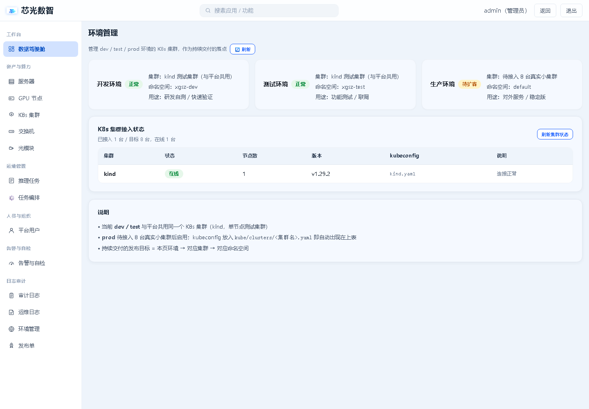

# 芯光数智 · 8 台真实 K8s 集群接入清单（P2-4）

> 当前状态：平台使用 **1 个 kind 单节点测试集群**（与 dev/test 环境共用）。
> 目标状态：**8 台真实小集群**，按环境/业务划分，发布单可选择目标集群。
> 说明：P2-4 依赖硬件到货与网络开通，代码侧已完成多集群 kubeconfig 加载，硬件就绪后按本文接入即可。

## 一、代码侧现状（已具备）

| 能力 | 说明 |
|---|---|
| 发布单 `cluster` 字段 | 创建发布单时填写目标集群名（默认 `kind`） |
| 多集群 kubeconfig | 按 `kube/clusters/<cluster>.yaml` 自动加载，找不到时回退默认 kubeconfig |
| 集群接入状态 | 「环境管理 → K8s 集群接入状态」扫描 kubeconfig，显示在线/节点数/版本/错误；接口 `GET /api/ops/v1/clusters` |
| 环境隔离 | `dev` / `test` / `prod` + `namespace` 组合定位 |
| 发布详情 | 显示目标集群 / 命名空间 / Deployment / Pod / 日志 |
| 滚动更新 | 按 RollingUpdate 策略发布，等待 Ready 并做健康检查 |
| 回滚 | 恢复到上一版本镜像与副本数 |

后端加载逻辑见 `xgsz-admin/apps/ops/k8s_release.py` 中的 `cluster_config_file` / `_api_client` / `check_clusters`；
容器内 kubeconfig 目录由 `KUBECONFIG_DIR=/root/.kube/clusters` 指定。
目标集群数量默认 8，可通过环境变量 `K8S_EXPECTED_CLUSTERS_COUNT` 调整。



## 二、硬件 / 网络准备

| 项 | 要求 |
|---|---|
| 集群数量 | 8 套（建议：dev 1、test 2、prod 5，或按业务线划分） |
| 单集群规模 | 3 节点起（控制面 1 + 工作节点 2），按业务调整 |
| 版本 | 与现网 kubectl / kubernetes Python client 兼容（当前 client 12.0.1，建议 K8s 1.19~1.24） |
| 网络 | 平台 backend 容器可访问每个集群的 API Server（6443 或自定义端口） |
| 权限 | 用于发布的 ServiceAccount / 用户需具备 Deployment、Pod、PodLog 的 get/list/watch/create/patch 权限 |
| 镜像仓库 | 8 个集群都能拉取业务镜像（Harbor / GHCR / 阿里云 ACR），或提前 `ctr images import` |
| 命名空间 | 每个环境预建 `xgsz-dev` / `xgsz-test` / `xgsz-prod`（或按需） |

## 三、逐台接入步骤

### 1. 导出 kubeconfig

在每台集群的控制面执行：

```bash
# 建议创建只读+发布的专用账号，避免直接用 admin.conf
kubectl -n kube-system create serviceaccount xgsz-deployer
kubectl create clusterrolebinding xgsz-deployer \
  --clusterrole=edit --serviceaccount=kube-system:xgsz-deployer

# 生成 kubeconfig（示例，按实际 API Server 地址调整）
kubectl -n kube-system get secret $(kubectl -n kube-system get sa xgsz-deployer -o jsonpath='{.secrets[0].name}') \
  -o jsonpath='{.data.token}' | base64 -d
```

把 kubeconfig 保存到平台服务器：

```bash
mkdir -p kube/clusters
# 文件名必须与发布单里的“目标集群”一致
cp cluster-01.kubeconfig kube/clusters/cluster-01.yaml
cp cluster-02.kubeconfig kube/clusters/cluster-02.yaml
# ... cluster-08.yaml
```

> 注意：kubeconfig 内 `server` 必须是**平台 backend 容器可达的地址**，不能写 `127.0.0.1`。
> 如果使用域名，确保容器 DNS 能解析；否则写内网 IP + `insecure-skip-tls-verify: true`（仅内网）。
>
> 更新 kubeconfig 后执行 `docker compose restart backend celery-worker celery-beat`，使多集群客户端缓存刷新。

### 2. 验证连通性

在平台服务器执行（需要 kubectl）：

```bash
for f in kube/clusters/*.yaml; do
  echo "=== $f ==="
  kubectl --kubeconfig "$f" get nodes -o wide
  kubectl --kubeconfig "$f" auth can-i create deployment -n xgsz-test
done
```

在 backend 容器内验证（推荐，能排除网络命名空间差异）：

```bash
docker compose exec backend python - <<'PY'
import glob, os
from apps.ops import k8s_release as k

class Probe:
    def __init__(self, cluster):
        self.cluster = cluster
        self.namespace = 'default'

for path in sorted(glob.glob('/root/.kube/clusters/*.yaml') + glob.glob('/root/.kube/clusters/*.yml')):
    name = os.path.basename(path).rsplit('.', 1)[0]
    try:
        nodes = k._core_api(Probe(name)).list_node().items
        print('%-12s OK  nodes=%d' % (name, len(nodes)))
    except Exception as e:
        print('%-12s FAIL %s' % (name, str(e)[:160]))
PY
```

或直接打开平台「发布单 → 新建」，目标集群填 `cluster-01`，先建一个测试应用发布验证。

### 3. 登记 CMDB 资产

在「资产管理 → K8s 集群」中新增 8 条记录，字段建议：

| 字段 | 示例 |
|---|---|
| 名称 | 生产集群-01 |
| API Server | https://10.0.1.11:6443 |
| 版本 | v1.24.6 |
| 节点数 | 3 |
| 环境 | prod |
| 负责人 | 张运维 |

CMDB 记录用于台账展示；发布单里的「目标集群」填 `kube/clusters/` 下对应的文件名（不含 `.yaml`）。

### 4. 环境 → 集群映射（建议）

| 环境 | 集群 | 命名空间 | 用途 |
|---|---|---|---|
| dev | cluster-dev | xgsz-dev | 研发自测 |
| test | cluster-test-01 / 02 | xgsz-test | 功能测试、联调 |
| prod | cluster-prod-01 ~ 05 | xgsz-prod | 对外服务、灰度 |

### 5. 发布验证

1. 「发布单 → 新建」：应用名、目标环境、目标集群 `cluster-01`、命名空间、镜像、副本数；
2. 审批通过 → 执行发布；
3. 打开详情：确认「K8s 实时状态」显示目标集群，Pod 列表出现 Running；
4. 点 Pod 行「日志」确认可读取；
5. 执行回滚，确认镜像恢复到上一版本。

## 四、硬件未到货前的临时方案

- 继续使用 kind 单集群，发布单目标集群保持 `kind`；
- 用 `kube/clusters/kind.yaml`（当前已配置）承载 dev/test；
- prod 在「环境管理」中标记为「待接入 8 台真实小集群」，不执行生产发布；
- 硬件到货后按本文逐台接入，无需改代码（只需放 kubeconfig + 填集群名）。

## 五、验收标准

- [ ] 8 个 `kube/clusters/*.yaml` 均可从 backend 容器访问 API Server
- [ ] 每个集群可创建/更新 Deployment，Pod 能 Running
- [ ] 发布单能按集群分发，详情页显示正确的集群/Pod/日志
- [ ] 回滚可恢复上一版本镜像与副本数
- [ ] CMDB 中 8 条 K8s 集群资产与 kubeconfig 文件名一致
- [ ] 生产环境发布有审批记录与审计日志

## 六、风险与注意事项

1. **权限最小化**：不要使用 cluster-admin kubeconfig，建议 `edit` ClusterRole + 限定命名空间；
2. **kubeconfig 保密**：`kube/` 已被 `.gitignore` 忽略，不要提交到仓库或交付包；
3. **并发发布**：同一 Deployment 不要同时执行两个发布单，当前按单发布单串行；
4. **镜像拉取**：8 个集群需提前配置镜像仓库凭据（imagePullSecrets），否则 Pod 会 ImagePullBackOff；
5. **健康检查**：当前健康检查基于 Deployment 的 Ready/Available 副本；如业务需要 HTTP 探针，后续可在发布单中增加端口与探针配置。
